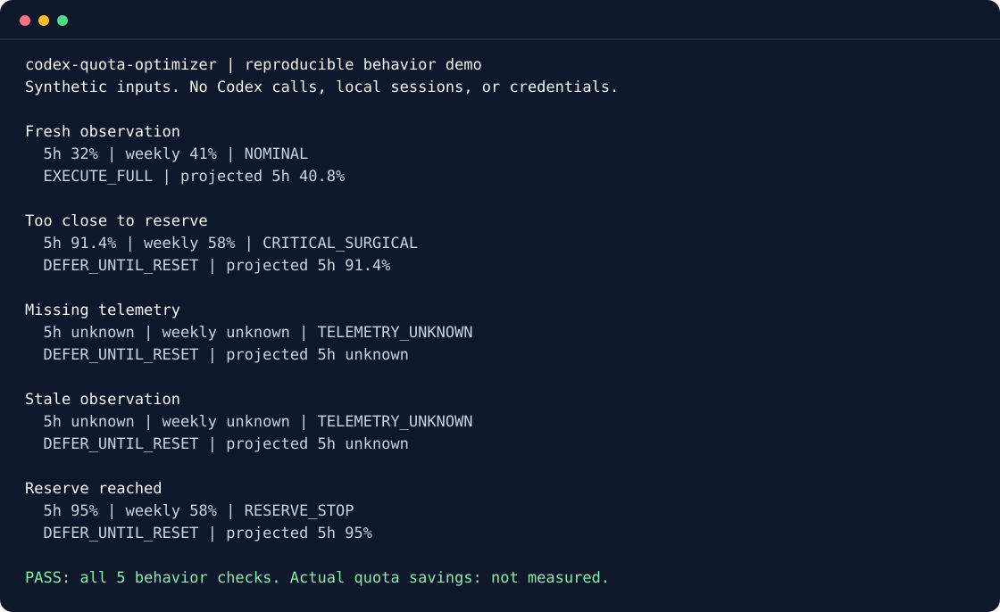

# codex-quota-optimizer (v0.3.0)

Offline Codex quota observations and a deterministic task scheduler. The skill reads local rollout logs without network requests, credentials, or extra model calls. The optional web app is a simulator, not a live quota monitor.

[](https://github.com/Thlookingatyou/codex-quota-optimizer/actions/workflows/test.yml)
[](LICENSE)

**See quota uncertainty before planning your next Codex task.** Read local observations, get task-sizing guidance, and see which estimated tasks fit below a 95% ceiling.

**Early project: real-world quota savings have not been measured.** The tests verify telemetry handling and scheduling behavior. The tool cannot increase your allowance, enforce server limits, or automatically change your active model.



*Reproduce this preview with `npm run demo`. These are synthetic inputs, not a recording of measured quota savings. [Plain-text output and explanation](docs/DEMO.md).*

## Try it before installing the skill

With Node.js 22.12 or later:

```sh
git clone https://github.com/Thlookingatyou/codex-quota-optimizer.git
cd codex-quota-optimizer
node scripts/demo.mjs
```

No `npm install`, API key, or Codex account is needed for this demonstration. It checks five behaviors using a fixed clock and synthetic observations. It neither reads your sessions nor installs or configures a skill.

## Install in about 30 seconds

Node.js 22.12 or later is required. The skill itself has no npm dependencies.

```sh
npx skills add Thlookingatyou/codex-quota-optimizer --skill codex-quota-optimizer
```

Or clone this repository and run `bash install.sh`. This copies the skill into `${CODEX_HOME:-$HOME/.codex}/skills`, appends the repository's lifecycle instructions to global `AGENTS.md` if absent, and registers the optional local MCP server in `config.toml`. Review these files before installing. Windows users can use Git Bash, or copy `skills/codex-quota-optimizer` into their Codex skills directory manually.

## A first real usage example

From a clone, inspect your available local observations:

```sh
node skills/codex-quota-optimizer/scripts/check_quota.mjs --task-size=M --format=json
```

This command only reads local logs. If both windows have usable observations, it reports their usage and a policy such as `NOMINAL` or `WARNING_CONSERVE`. If either window is missing or stale, expect `TELEMETRY_UNKNOWN` and `null` headroom rather than sample percentages. Use the installed skill's script path after installation.

For example, the synthetic demo starts at 91.4% 5h usage. A 10-point task assigned the minimal .38 multiplier would end at 95.2%, so the scheduler defers it. This illustrates a reserve decision; it does not measure actual consumption.

## Limitations and evidence

- **Savings are unmeasured.** Cost multipliers and model routing are heuristics. Fewer scheduled tasks are not evidence that completing the same work consumes less quota. See the [benchmark protocol](docs/BENCHMARK.md).
- **Local observations can be absent, delayed, rounded, or stale.** Log formats and account limits may change. A passed reset time does not prove usage returned to zero.
- **95% is a projection ceiling.** Incorrect estimates or other sessions can still exhaust your allowance. The skill offers advice; it cannot enforce a server-side quota.
- **No automatic model switching.** Check model availability in your own client. The optional web app is a simulator.
- **Installation has distinct scopes.** The demo writes no settings. `bash install.sh` changes the global skill, instructions, and MCP registration as described above; the `npx skills` route uses that installer's scope choices.

## Help test or improve it

Try the demo, then tell us whether real local telemetry is available on your platform. Useful feedback includes the exact command, expected result, actual result, OS, Node and Codex versions. Share only a small, redacted rate-limit event; full rollout logs may contain prompts, paths, and confidential content.

- [Report a bug or suggest an improvement](https://github.com/Thlookingatyou/codex-quota-optimizer/issues/new/choose).
- [Find a good first issue](https://github.com/Thlookingatyou/codex-quota-optimizer/issues?q=is%3Aissue%20is%3Aopen%20label%3A%22good%20first%20issue%22).
- Read [CONTRIBUTING.md](CONTRIBUTING.md) for setup, tests, contribution scope, and pull-request guidance.
- Submit a reproducible measurement using the [benchmark protocol](docs/BENCHMARK.md), including negative or inconclusive results.

## Read telemetry

```sh
node skills/codex-quota-optimizer/scripts/check_quota.mjs --format=json --task-size=M
node skills/codex-quota-optimizer/scripts/check_quota.mjs --codex-home=/path/to/codex --format=json
node skills/codex-quota-optimizer/scripts/check_quota.mjs --rollout-file=/path/to/rollout.jsonl --format=json
```

The reader selects the newest event timestamp across readable `sessions/**/rollout-*.jsonl` files, not the most recently modified file. It supports `payload.rate_limits`, top-level `rate_limits`, and `msg.rate_limits`, with `primary`/`secondary` or `primary_window`/`secondary_window`. Only 300-minute and 10080-minute windows qualify. Named buckets other than `codex` are ignored because they may describe different model limits.

Observations older than 15 minutes, invalid/future timestamps (over 60 seconds ahead), and expired reset times are stale. Relative resets are aged from the observation timestamp; absolute `resets_at` values use Unix seconds. An expired observation does not imply zero usage after a reset.

Missing, unreadable, malformed, partial, or stale data produces `null` usage/headroom and `TELEMETRY_UNKNOWN`, with per-window status and the original observed usage when available. Unknown reset times remain `null`/`unknown`. Task sizing remains available; quota-budgeted scheduling defers until both windows are known. A known window at the reserve ceiling still triggers `RESERVE_STOP` even if the other window is missing.

Explicit `--5h=`, `--weekly=`, `--5h-reset-sec=`, `--weekly-reset-sec=`, and `--plan=` values support controlled simulations. Environment equivalents are `CODEX_PRIMARY_USED_PCT`, `CODEX_WEEKLY_USED_PCT`, `CODEX_PRIMARY_RESET_SEC`, `CODEX_WEEKLY_RESET_SEC`, and `CODEX_PLAN_TYPE`. Overrides are identified as manual inputs, never live telemetry. A single override leaves the other window unknown if no valid observation exists. Invalid percentages fail with a nonzero exit code.

## Model guidance

Checked against [official OpenAI model guidance](https://learn.chatgpt.com/docs/models?surface=cli) on November 5, 2026. XS/S tasks recommend `gpt-6-luna` with high reasoning; M/L recommend `gpt-6.1-sol` with medium reasoning; XL recommends Sol with high reasoning. These are project heuristics. Astra is an option for demanding work and Terra for writing/visual tasks; account and client availability must be checked before switching. Recommendations do not change the active model.

Model IDs and reasoning effort are separate settings. Legacy `gpt-5-codex`, invented effort-suffixed IDs, and `codex-mini-latest` are no longer recommended. No fixed token saving or allowance multiplier is guaranteed.

## Schedule tasks

```sh
node skills/codex-quota-optimizer/scripts/optimize_work_plan.mjs --5h=88 --weekly=45 --tasks='[{"title":"Fix crash","priority":"P0","est_5h_pct":12,"est_weekly_pct":3}]'
```

Tasks sort P0, P1, P2 while preserving order within a priority. Estimates must be finite and nonnegative. Defaults are 10 percentage points for 5h and 24% of that estimate for weekly. Execution tiers use illustrative cost multipliers (full .88, compact .62, minimal .38). Each selected cost is rounded to one decimal and checked against **both** projected windows before accepting a task. Deferred work consumes zero estimated budget. A task may end exactly at 95%; subsequent work defers.

Both schedulers enforce a ceiling of at most 95%. `CODEX_QUOTA_RESERVE_PCT` can request a larger reserve. Reported limits apply to all plans, including Pro and Enterprise; plan names do not grant exemptions. These estimates cannot prevent actual server-side rate limits. Recheck telemetry between tasks.

The MCP wrapper exposes `get_codex_usage_limits` and `optimize_codex_task_plan` with the same reader and scheduler, including missing-telemetry behavior:

```sh
node skills/codex-quota-optimizer/scripts/mcp_server.mjs
```

## Develop and verify

```sh
npm ci
npm run lint
npm test
npm run build
npm run dev
```

`npm start` runs the same local TypeScript server. For production, build first and set `NODE_ENV=production`. Starting the server never publishes a repository; publishing requires an explicit action in the app.

The dependency-free regressions can run without installing the web app:

```sh
npm run test:skill
```

Tests include fixture JSONL events, missing telemetry through both CLIs and MCP, stale/expired resets, timestamp ordering, invalid inputs, model routing, and reserve boundaries in both schedulers. `tests/fixtures/rate-limits.json` is a synthetic event with a fixed clock in tests. Manual CLI tests should use fresh timestamps or explicit overrides.

`skills/codex-quota-optimizer` is canonical. Run `npm run sync:skill` after changes; tests verify `.agents/skills/codex-quota-optimizer` matches byte for byte. `npm pack --dry-run` checks distribution contents, including the skill, app sources, and tests. The lockfile pins its dependency tree.

MIT license. Repository: [Thlookingatyou/codex-quota-optimizer](https://github.com/Thlookingatyou/codex-quota-optimizer).
